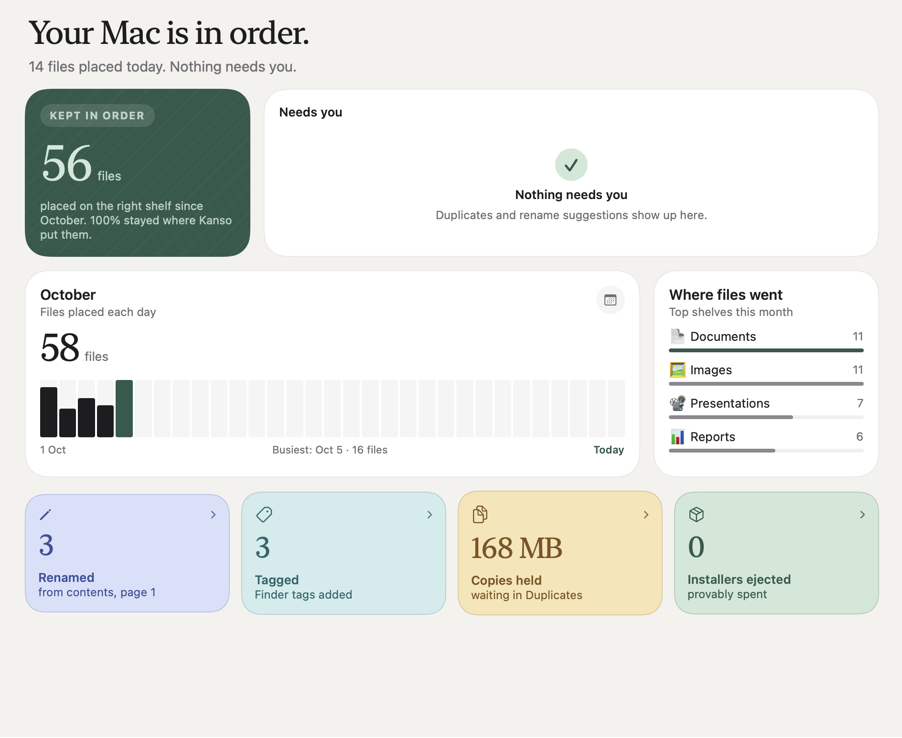
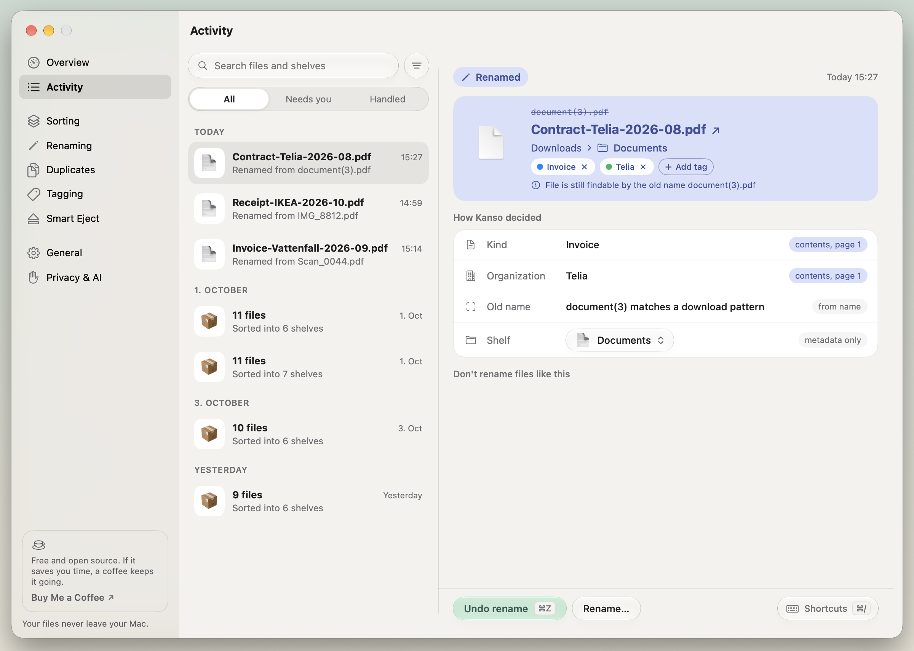
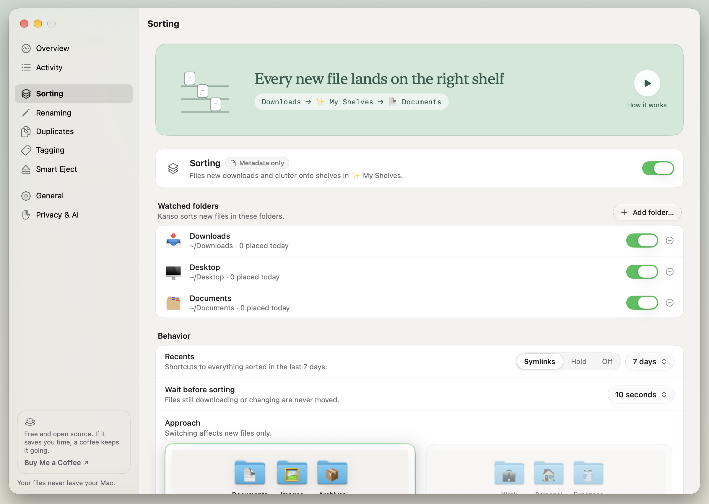
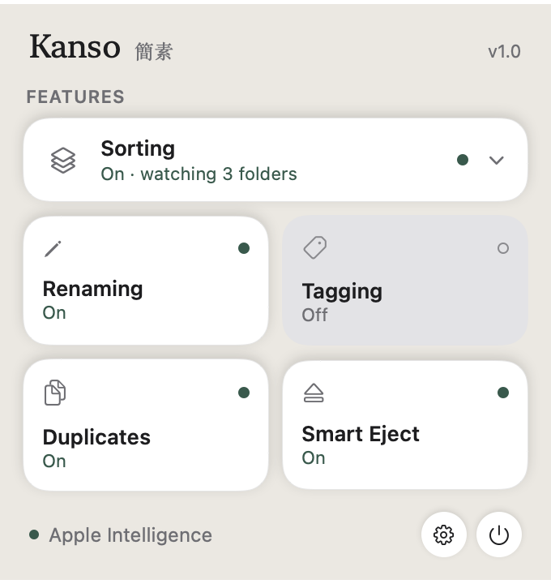
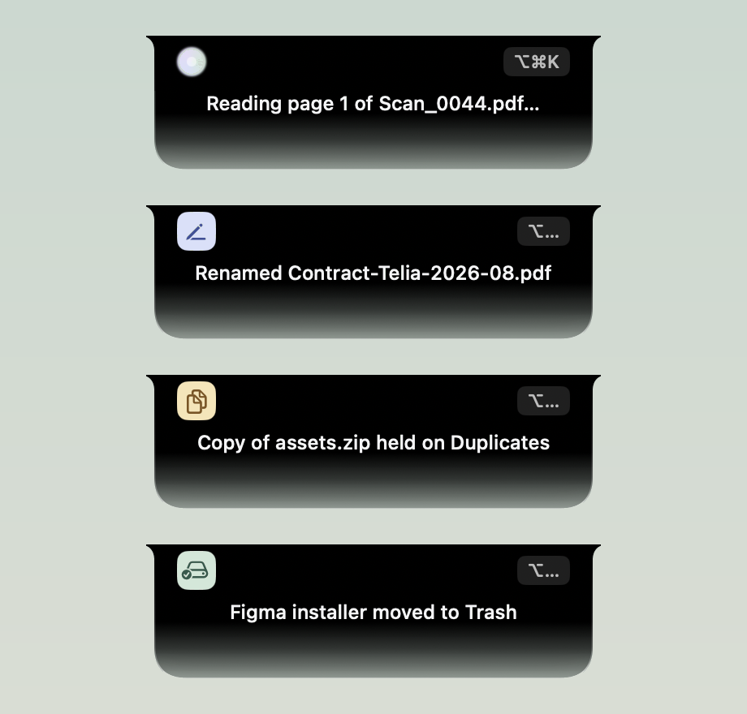
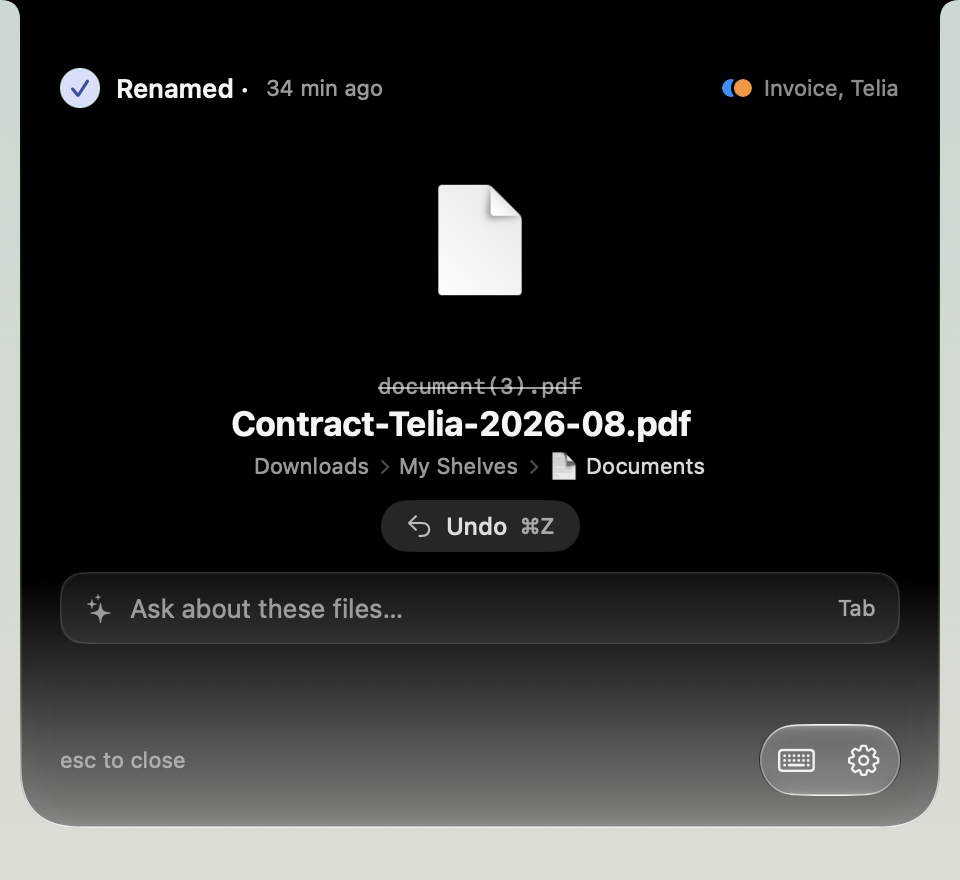
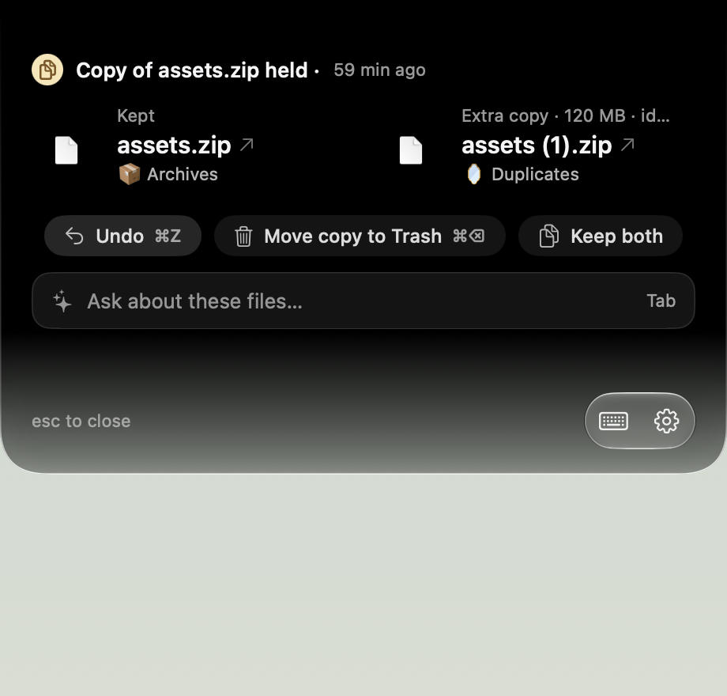
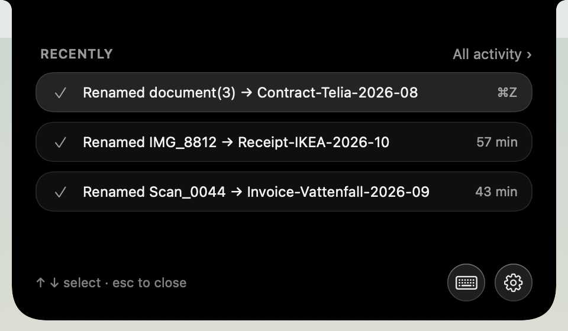

<p align="center"></p>


## *KANSO IS STILL IN EARLY DEVELOPMENT STAGE*

# Kanso

Keeps `~/Downloads`, `~/Desktop` and `~/Documents` sorted without you thinking about it.

- Files are sorted by **type**, using the extension (and the screenshot flag), into `My Shelves/<Type>`. Each type folder gets a Finder icon with its emoji.
- New arrivals also show up in `Recents` as symlinks for a week, so you can still find what you just downloaded.
- `Manual Shelves` is yours: Kanso never moves anything in or out of it.
- **Models only run for unknown types.** Apple Intelligence (the on-device Foundation Model) picks a type or creates a new one with its own emoji (for example 🔑 Certificates for `.p12`). The choice is remembered for that extension, so the next file like it skips the model. Anything still unclear goes to `Unsorted`.
- Models see only **metadata**: the file name, type, download URL and screenshot flag. File contents are never opened, and nothing leaves your Mac.

```text
~/Downloads/
  My Shelves/     📄 Documents  📊 Reports  🖼️ Images  🎬 Videos  💻 Code  📦 Archives  …
  Manual Shelves/ yours, never touched
  Recents/        symlinks to what was sorted in the last `recent_days`
```

`recents` in the config picks the mode:
- `"links"` (the default): sort now and leave a symlink in Recents.
- `"hold"`: the file itself waits in Recents for `recent_days`, then gets sorted.
- `"off"`: no Recents at all.

## Features

- **Sorting by type.** New files in your watched folders land on a shelf in `My Shelves`, decided by extension. Unknown types go to Apple Intelligence, which picks a shelf or creates one. Only the top level is sorted.
- **Recents.** Symlinks to what was just sorted, so a new download is never lost.
- **Renaming.** Meaningless names (`Scan_0044.pdf`) become `Invoice-Vattenfall-2026-09.pdf`, read on this Mac from the first page. Large batches wait for your review, and the old name stays searchable.
- **Tagging.** Adds Finder tags for the kind of document and the organization.
- **Duplicates.** Finds copies by size and hash, keeps one, and holds the rest on a shelf or moves them to the Trash.
- **Smart Eject.** Ejects a mounted `.dmg` and trashes it once the app is installed.
- **The island.** A small panel at the top of the screen, opened with ⌥⌘K, that shows what Kanso did, what needs you, and an ask field answered on device.
- **Activity.** Every action is listed with how Kanso decided, and every action can be undone.
- **Your own rules.** Match by name, extension or download source and send files to the shelf you want. Kanso learns from your corrections.
- **Private.** File contents are read only on your Mac, a little, and kept nowhere. Keys, vaults and Manual Shelves are never read.

## Screenshots

### The app

<table>
<tr>
<td width="50%" valign="top"><br><b>Overview</b><br>What was sorted, what needs you, where files went.</td>
<td width="50%" valign="top"><br><b>Activity</b><br>Every action, how Kanso decided, and Undo.</td>
</tr>
<tr>
<td width="50%" valign="top"><br><b>Sorting</b><br>Watched folders, Recents and how long to wait.</td>
<td width="50%" valign="top"><br><b>Quick settings</b><br>Turn each feature on or off from the menu bar.</td>
</tr>
</table>

### The island

<table>
<tr>
<td width="33%" valign="top"><br><b>Compact</b><br>Working, renamed, duplicate held, installer trashed.</td>
<td width="33%" valign="top"><br><b>Renamed</b><br>The new name, tags and Undo.</td>
<td width="33%" valign="top"><br><b>Needs you</b><br>A duplicate waiting for Move to Trash or Keep both.</td>
</tr>
<tr>
<td width="33%" valign="top"><br><b>Recent</b><br>The latest actions, one key away (⌥⌘K).</td>
<td></td><td></td>
</tr>
</table>

## Install

```bash
uv sync
uv run kanso run --all --dry-run   # preview what it would do with what's already there
uv run kanso install               # start the background agent
```

Then open **System Settings → Privacy & Security → Full Disk Access** and add the Python path that `install` prints. Without it, macOS blocks background access to Desktop, Documents and Downloads.

`install` only affects items that arrive after it runs. Run `kanso run --all` to clean up what's already there.

### Menu bar app

```bash
menubar/build.sh    # builds, installs to ~/Applications/Kanso.app and launches it
```

From the menu bar you can turn auto-sort on or off, add or remove folders to sort, sort new files now, sort everything, undo the last sort, edit rules, and set up folder access. The app only calls the `kanso` CLI in this folder. Sorting happens in the background agent, even when the app is closed.

| command | |
|---|---|
| `kanso run [--all] [--dry-run]` | sort now |
| `kanso undo` | revert the last run and remove its Recents links; restored items get the `Keep` tag, so Kanso leaves them alone |
| `kanso status` | agent state, and whether Apple Intelligence is in use |
| `kanso config` | open `~/.config/kanso/config.toml` |
| `kanso uninstall` | remove the agent (config and journal stay) |
| `kanso roots DIR...` | set the folders to sort |

A launchd agent (`WatchPaths`) runs Kanso when a watched folder changes, and hourly to expire Recents. Nothing stays resident, and models load only when a file has an unknown type. The log is at `~/Library/Logs/tidy.log`.

## Apple Intelligence

Needs macOS 26, Apple Intelligence turned on, and **Xcode 26** to build Apple's `apple-fm-sdk` Python bindings:

```bash
uv sync --extra apple              # add --group bench to keep the benchmark models installed
```

Without it, unknown files go to `Unsorted`.

## Your own rules

These go in `config.toml`. They're checked from the top, and the first match wins:

```toml
[[rules]]
glob = "*rechnung*"                    # file name pattern
dest = "Documents/Invoices"             # inside My Shelves; absolute paths work too
tags = ["Invoice"]

[[rules]]
from = "github.com"                    # text in the download URL
dest = "~/Developer/Downloads"
```

Types are config too: `[categories.<Type>]` with `emoji`, `description` and `match` (extensions). Models read the descriptions when they classify unknown types. Types created by Apple Intelligence are kept in `~/.config/kanso/learned.json`. You can edit or delete that file to reset them.

`[context]` holds the old content-based subfolders (Finance, Work, Personal…). Nothing uses it yet; it's reserved for AI tagging, renaming and context-aware sorting.

Default rules send JSON exports of automation workflows to Automations when they were downloaded from make.com, zapier.com or an n8n host, and do the same for files named `*blueprint*.json`. These tools have no file extension of their own.

## Safety

- Only the top level of each root is touched. Kanso never looks inside subfolders, including `My Shelves`, `Manual Shelves` and `Recents`.
- Folders stay where they are unless you set `sort_folders = true`. Folders containing `.git` never move. App and document bundles (`.app`, `.key`…) count as files.
- To exclude one file, right-click it in Finder → **Don't Sort with Kanso** (**Allow Kanso to Sort** reverses it). This sets the `Keep` Finder tag. In some macOS versions these items are under Quick Actions or Services.
- It skips hidden files, partial downloads (`.crdownload`, `.download`, `.part`), Office lock files, and anything still changing.
- Name clashes become `name 2.ext`. Nothing is overwritten.
- Every move is journaled (`~/.config/kanso/journal.jsonl`) before Kanso moves on.
- **iCloud Drive:** add `~/Library/Mobile Documents/com~apple~CloudDocs` to `roots`. File contents are never read, so files that aren't downloaded stay that way.

## Tests

```bash
uv run python -m unittest discover tests -v
uv run python bench.py >> BENCHMARKS.md    # compare approaches on your real folders (dry run)
```

## License

MIT. See [LICENSE](LICENSE).
